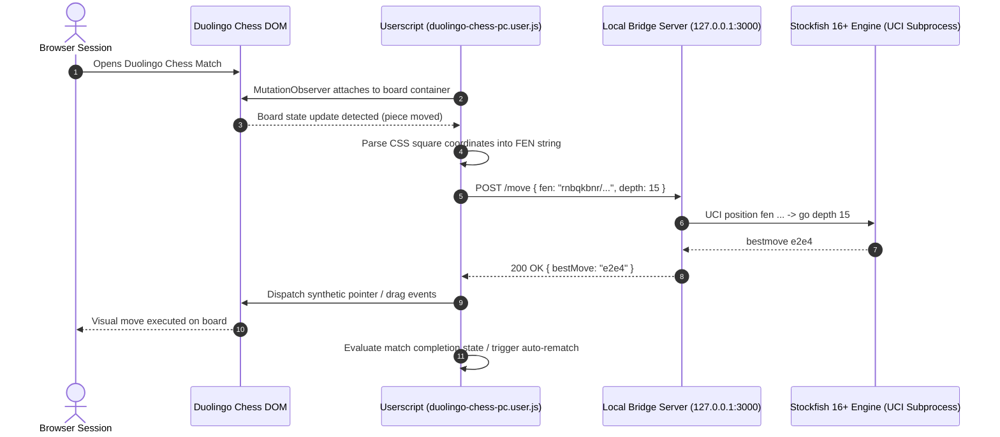

# duolingo-chess-bot

[](https://github.com/itsgoharrehman/duolingo-chess-bot/releases/tag/v1.1.0) [](https://developer.mozilla.org/en-US/docs/Web/JavaScript) [](https://nodejs.org) [](https://stockfishchess.org) [](https://www.tampermonkey.net) [](LICENSE)

An automated chess solver and browser userscript engineered to interface with Duolingo Chess. Combines client-side DOM mutation tracking with a lightweight local Stockfish 16+ engine server to evaluate chess positions and execute optimal moves with millisecond latency.

---

## Architecture and Execution Flow



---

## Core Capabilities

* **Real-Time Board Synchronization**: A targeted `MutationObserver` watches Duolingo's SVG and CSS piece layouts, extracting piece positions into standard Forsyth-Edwards Notation (FEN) in under 10ms.
* **Local Stockfish Engine Bridge**: A local Node.js bridge server communicates with the native Stockfish 16 executable via standard UCI (Universal Chess Interface) streams, avoiding browser WebAssembly thread limits.
* **Aggressive Fast-Mate Pathfinding**: Configurable search depths (default depth 12-18) tuned for rapid checkmate discovery in speed matches.
* **Synthetic Humanized Pointer Drag**: Dispatches genuine `PointerEvent` sequences (pointerdown, pointermove, pointerup) to emulate natural user interaction and satisfy game input listeners.
* **Continuous Match Loop**: Automatically detects "Match Over" modals and triggers the next match button to sustain automated evaluation sessions.

---

## Repository Structure

```
duolingo-chess-bot/
├── .github/
│   ├── ISSUE_TEMPLATE/
│   │   ├── bug_report.yml          # Structured bug report form
│   │   └── feature_request.yml     # Structured feature request form
│   ├── PULL_REQUEST_TEMPLATE.md    # Pull request verification checklist
│   └── dependabot.yml              # Automated weekly npm dependency scanner
├── duolingo-chess-pc.user.js       # Tampermonkey / Violentmonkey client userscript
├── package.json                    # Project metadata, engine scripts, and dependencies
├── run-local-stockfish.bat         # Windows one-click server starter script
├── setup-stockfish.js              # Automated Stockfish binary download and extractor
├── stockfish-server.js             # Local Node.js HTTP server communicating via UCI
├── LICENSE                         # MIT License
├── SECURITY.md                     # Security policy and localhost isolation invariants
├── CONTRIBUTING.md                 # Contribution guidelines
└── CODE_OF_CONDUCT.md             # Contributor Covenant v2.1
```

---

## Configuration Reference

Userscript configuration parameters are customizable at the head of `duolingo-chess-pc.user.js`:

| Parameter | Default | Description |
| :--- | :--- | :--- |
| `SERVER_URL` | `http://localhost:3000` | Local Stockfish HTTP bridge endpoint |
| `DEFAULT_DEPTH` | `15` | UCI search depth for move calculation |
| `MOVE_DELAY_MIN` | `250` | Minimum delay in milliseconds before move execution |
| `MOVE_DELAY_MAX` | `600` | Maximum delay in milliseconds for simulated human cadence |
| `AUTO_REMATCH` | `true` | Automatically clicks 'Play Again' upon match completion |

---

## Setup and Installation

### 1. Prerequisites
* Node.js v18 or later
* Tampermonkey or Violentmonkey extension installed in your browser

### 2. Install Engine and Bridge Server
```bash
git clone https://github.com/itsgoharrehman/duolingo-chess-bot.git
cd duolingo-chess-bot
npm install
npm run setup
```

### 3. Start Local Stockfish Server
```bash
npm start
# or on Windows:
run-local-stockfish.bat
```
The bridge server will listen on `http://127.0.0.1:3000`.

### 4. Install Browser Userscript
1. Open Tampermonkey dashboard in your browser.
2. Create a new userscript and copy the contents of `duolingo-chess-pc.user.js`.
3. Save the script and navigate to Duolingo Chess.

---

## Security Policy

* **Localhost Binding**: The Stockfish bridge server strictly binds to loopback interface `127.0.0.1`. It must never accept inbound connections from public networks.
* **Disclosure**: See [SECURITY.md](SECURITY.md) for vulnerability reporting procedures.

---

## Disclaimer

This software is developed strictly for research, algorithmic study, and computer chess evaluation experimentation. Maintainers do not endorse unauthorized cheating or violation of terms of service.

---

## License

This project is licensed under the [MIT License](LICENSE).
